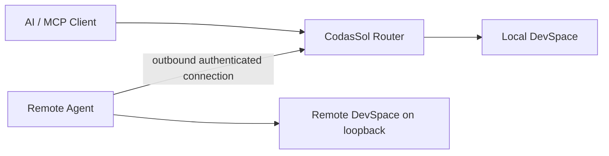

<div align="center">

# CodasSol Router

### **Route the Project, Not Devices.**

**Give the order anywhere. CodasSol finds the machine that owns the workspace.**

[](https://github.com/SeanWu089/CodasSol-Router/releases/latest)
[](https://nodejs.org/)
[](LICENSE)
[](https://modelcontextprotocol.io/)

**A thin, self-hosted routing layer that lets AI agents work across your computers without making you choose the machine every time.**

</div>

> **Current codebase (2026-10-10):** The default branch includes the tested
> **Device Registry v1**, **CodasSol-mac v0.3.2** menu-bar app, and Mac-side
> workspace routing / wrong-device protections. These components were
> verified on macOS. The cross-network, **Mac-offline Windows v0.2** goal is
> **still under development**: Windows can report an Agent heartbeat even
> when its DevSpace cannot execute commands. Do not interpret a registered
> device as execution-ready. See [distributed routing](docs/distributed-routing.md).

---

## What is CodasSol Router?

Your files do not live on one computer.

Your projects might be on a MacBook, a Windows desktop, a home server, a GPU box, or a machine you left at the office. Traditional remote access lets you *reach* those machines — but you still have to remember where the work lives, connect to the right host, and switch context yourself.

CodasSol Router makes the **physical machine a routing detail**.

It sits in front of [DevSpace](https://www.npmjs.com/package/@waishnav/devspace) and exposes one MCP-facing entry point:

```text
You / AI client
      |
      | one MCP endpoint
      v
CodasSol Router
      |
      | "Where does this workspace live?"
      |
      +----> Mac DevSpace ------> /Users/.../project
      |
      +----> Windows Agent -----> DevSpace -----> C:\Users\...\project
```

Open a Windows workspace from a conversation currently executing through a Mac Router, and CodasSol routes the call to Windows. After the workspace is opened, its `workspace_id` stays bound to that device, so later reads, edits, shell commands, and Git operations keep going back to the same machine automatically.

> **The AI should care about the workspace — not which box happens to hold it.**

---

## The fun version

Instead of:

```text
"Which computer has that file?"
-> remote desktop
-> switch machine
-> find project
-> reconnect tools
-> do the thing
```

you can aim for:

```text
"Move a shortcut on my Windows desktop to the Recycle Bin."
```

and the path becomes:

```text
AI client
   -> CodasSol Router on Mac
      -> C:\Users\...\Desktop resolves to Windows
         -> Windows Agent
            -> local DevSpace
               -> action happens on Windows
```

No separate Windows MCP endpoint needs to be exposed to the client, and the remote machine does not need an inbound public port.

---

## Why build this on DevSpace?

CodasSol does **not** try to replace DevSpace.

DevSpace is the execution backend: it owns local workspaces, filesystem operations, shell execution, coding-agent integrations, and local permission boundaries. CodasSol adds the missing **multi-device control plane** in front of it.

| Capability | DevSpace | CodasSol Router + DevSpace |
| --- | :---: | :---: |
| Local workspace / file / shell tools | ✅ | ✅ |
| Local allowed-root boundary | ✅ | ✅ |
| One MCP entry point | ✅ | ✅ |
| Multiple physical computers behind that entry point | — | **✅** |
| Device registry + online presence | — | **✅** |
| Windows/macOS-aware path routing | — | **✅** |
| `path -> device` selection | — | **✅** |
| Sticky `workspace_id -> device` binding | — | **✅** |
| Outbound-only remote Agent transport | — | **✅** |
| Fail closed on ambiguous/offline routes | — | **✅** |
| Per-device enrollment credentials | — | **✅** |
| Self-contained Windows Agent installer | — | **✅** |

> **DevSpace decides how work happens on a machine. CodasSol decides which machine should receive the work.**

---

## Routing model

CodasSol V1 uses a small set of deterministic rules.

### 1. Path chooses the device

Each device advertises explicit workspace roots.

```text
Mac
  /Users/you/...

Windows
  C:\Users\you
  D:\
```

An `open_workspace` call is matched with platform-aware path semantics. The most specific matching online device wins.

### 2. Workspace identity becomes device affinity

When DevSpace returns `workspace_id = ws_xxx`, CodasSol persists:

```text
ws_xxx -> device_id
```

Every later MCP call carrying that `workspace_id` returns to the same device.

### 3. Ambiguity fails closed

CodasSol does not silently guess when:

- multiple devices are equally valid;
- a bound device is offline;
- one MCP batch tries to cross devices;
- a workspace has no valid binding.

Wrong-machine execution is worse than an explicit routing error.

---

## Network model

> **v0.2 development:** the original Mac-hosted Router remains supported, but
> independent Router nodes and authenticated peer routing are now under
> development. See [Distributed routing v0.2](docs/distributed-routing.md)
> for the explicit Mac-offline behavior and setup boundaries. Do not mistake
> independent Router nodes for automatic failover of a client URL.

Remote Agents connect **outbound** to the Router.



The remote computer does **not** need a public IP, inbound firewall rule, its own public MCP URL, or a second public tunnel just for CodasSol.

The Router creates a one-time enrollment boundary, then issues a separate long-lived token for that device. DevSpace OAuth stays local to each computer.

---

## Quick start

### Router machine

Requirements: Node.js 22+ and an initialized local DevSpace.

```bash
git clone https://github.com/SeanWu089/CodasSol-Router.git
cd CodasSol-Router

npm test
./scripts/mac/install-autostart.sh
```

Check the Router and get the pairing token:

```bash
curl http://127.0.0.1:17676/_codassol/health
npm run router:lan
npm run router:pairing-token --silent
```

### Windows Agent

Download the latest **`CodasSol-Windows-Agent-*.zip`** from **[GitHub Releases →](https://github.com/SeanWu089/CodasSol-Router/releases/latest)**.

Then:

1. Extract the ZIP.
2. Double-click `INSTALL.cmd`.
3. Choose the workspace-access policy.
4. Enter the Router URL.
5. Paste the one-time pairing token.

The installer carries its own Node.js 22 x64 runtime, installs DevSpace privately under `%LOCALAPPDATA%\CodasSol\Agent`, and creates current-user autostart tasks.

Recommended Windows access policy:

```text
C:\Users\<you>
+ all fixed non-system drives
```

It intentionally does **not** expose the whole `C:\` system drive by default.

Verify from the Router:

```bash
npm run router:agents --silent
```

Full Windows details: [`docs/windows-setup.md`](docs/windows-setup.md)

---

## Security by default

- **Loopback-first Router** — default listener is `127.0.0.1`.
- **Outbound remote Agents** — remote machines initiate the connection.
- **One-time pairing token** — used only to enroll a device.
- **Different per-device token** — enrollment credentials are not reused as runtime credentials.
- **Local DevSpace OAuth** — DevSpace owner/access/refresh tokens stay on their own machine.
- **Explicit allowed roots** — Windows DevSpace roots and advertised Router roots are synchronized.
- **No whole-system-drive default** — the recommended Windows policy avoids exposing `C:\`.
- **Fail-closed routing** — ambiguity or offline state produces an error instead of a guess.
- **Private state stays outside Git** — tokens, device records, bindings, and local paths remain private.
- **Public release bundles contain no build-machine LAN address by default** as of `v0.1.2`.
- **Public installer examples use neutral placeholders** as of `v0.1.3`.

Read [`SECURITY.md`](SECURITY.md) before exposing a Router beyond a trusted network.

---

## What CodasSol is — and is not

**Not another remote desktop.** Remote desktop streams a screen and input. CodasSol routes structured agent/tool operations to the correct execution environment.

**Not a VPN replacement.** VPNs solve private network reachability. CodasSol solves agent action routing and workspace affinity. They can complement each other.

**Not an AI model.** CodasSol does no inference. Bring the AI client/model you want; DevSpace remains the execution layer.

**Not a hosted service.** The public repository is the framework. Device identities, credentials, paths, and bindings belong to your private deployment.

---

## Why the routing abstraction matters

There are already strong projects for multi-device agent execution, remote desktops, gateways, and self-hosted workers.

CodasSol deliberately explores a smaller abstraction:

```text
workspace identity
       |
       v
physical-machine affinity
```

The user or model should not need to call `remote_exec(agent_id="windows-pc", ...)` for every operation. Once a workspace is resolved, normal DevSpace tools keep their normal shape. The Router carries the machine affinity.

That makes CodasSol closer to a **transparent workspace router** than a remote-control dashboard.

---

## Releases

### `v0.1.3` — current

Public artifact hygiene. Installer examples use neutral placeholders rather
than test-machine-looking usernames or addresses.

### `v0.1.2`

Public bundle privacy hotfix. Public Windows artifacts no longer embed the build machine's LAN Router address.

### `v0.1.1`

Fixed the first real multi-device integration issue: DevSpace `allowedRoots` and Agent-advertised roots could disagree on an existing Windows installation. The installer now synchronizes both and offers an explicit access policy.

### `v0.1.0` — historical / superseded

First self-contained Windows Agent bundle. Kept as a prerelease so the development history remains inspectable.

See **[all Releases](https://github.com/SeanWu089/CodasSol-Router/releases)**.

---

## Where this can go

The next useful layers are not “more AI.” They are **better control over a personal compute fabric**:

- per-action approvals and capability policies;
- audit logs and device activity history;
- device aliases, tags, groups, and capability-aware routing;
- signed Agent updates and protocol compatibility checks;
- Linux packaging and service installers;
- GUI/browser/computer-use capabilities behind explicit permissions;
- mobile-first command and approval surfaces;
- secure Internet reachability without directly exposing the Router;
- task hand-off between machines;
- wake/sleep awareness and Wake-on-LAN;
- separate device presence from execution-backend health, with automatic DevSpace recovery;
- routing by hardware capability (`gpu`, `cuda`, `macos`, `office-pc`) in addition to path;
- consumer workflows such as “send me that file,” “start this download,” or “run this task at home.”

> **What if all of your computers behaved like one addressable pool of capabilities?**

---

## Development

```bash
npm test
```

See [Git branches, worktrees, and release workflow](docs/git-workflow.md)
for the current `main`/`develop` policy, protected in-progress worktrees,
and a clean history view that excludes internal DevSpace review snapshots.

Current V1 tests cover Agent enrollment/heartbeat/job transport, local DevSpace OAuth, Windows path semantics, most-specific-root selection, ambiguity/offline fail-closed behavior, sticky workspace bindings, cross-device batch rejection, Router proxying, and health checks.

---

## Public framework vs. private deployment

Never commit or publish real device credentials, pairing secrets, local path inventories, workspace bindings, tunnel credentials, API keys, or certificates/private keys.

Local Router state belongs under `~/.codassol/`. Windows Agent state belongs under `%USERPROFILE%\.codassol\`.

---

**Experimental Device Registry v1:** See [the device directory and authenticated rename API](docs/distributed-routing.md#device-registry-v1-experimental-api) for cross-node discovery, stable installation identity, peer metadata synchronization and offline display semantics.

## License

MIT.

<div align="center">

### **Route the Project, Not Devices.**

</div>

## macOS menu bar controller (v0.3.2)

Build the native Swift/AppKit menu app with `zsh scripts/mac/menu-app/build.sh`
(default destination: `~/Applications/CodasSol-mac.app`). Launch it from
Finder or `open -a "$HOME/Applications/CodasSol-mac.app"`. It probes the local
DevSpace (`127.0.0.1:7676/healthz`) and Router
(`127.0.0.1:17676/_codassol/health`) independently. The managed DevSpace
LaunchAgent is `com.codassol.devspace.mac`; the Stop action is enabled only
after confirming the managed process actually owns the listener. DevSpace
is discovered by its published `dist/cli.js` entrypoint, not a fragile npm
shim. Installing the menu app does **not** restart the Router.

The menu app status item uses a monochrome macOS template icon derived from the local `sean.PNG` avatar, bundled as `scripts/mac/menu-app/SeanTemplate.png`. For local upgrades, rebuild and relaunch the menu app; server restart is not required.

The installed macOS app is named **CodasSol-mac.app**, has a full-color avatar Finder icon derived from `sean.PNG`, and uses a 21-point monochrome template icon for the menu bar.

### CodasSol-mac v0.3 device panel (preview)

The native menu-bar icon opens a compact SwiftUI device panel: local Mac first,
then any registered peer/Agent devices, with detail pages, rename and local
DevSpace management controls. No Electron, full Xcode, or web runtime required.
The status bar continues to use the **black-and-white Sean template**; the
Finder app icon retains the existing **blue Sean icon**.

`scripts/mac/menu-app/DeviceDirectoryClient.swift` reads the authenticated
Device Registry v1 API (`/_codassol/devices`) from **loopback only**, taking
the local admin bearer from the private `~/.codassol/router.json` state file.
It never forwards this token to remote devices. Until Registry v1 is deployed,
the UI falls back to **actual local Router Agent and Peer registrations** in
the private state and peers files, marking their state **Unknown** (legacy
registrations have no reliable recent heartbeat data) and disabling remote rename. The local
Router and DevSpace statuses are still probed live. With Registry v1 installed,
local-first status and authenticated rename become available without replacing
the menu UI. No production Router restart or protocol migration is required
to install the UI preview.

`npm run test:mac` now exercises a mock authenticated Registry Router, device
listing and rename, legacy 404, wrong credentials, and saved legacy records,
in addition to existing macOS LaunchAgent and migration regression checks.
The real Mac/Windows multi-node Registry deployment and login-reboot test
remain separate, potentially disruptive integration stages.

**v0.3.1 polish:** The normal device list does not show Registry deployment or
developer diagnostic messages. Previously enrolled Agent and configured Peer
records both appear; an unregistered phone does not. Legacy detail names are
read-only instead of offering a save button that could not succeed. The Stop
button is only available after confirming the managed LaunchAgent PID matches
the actual TCP/7676 listening process, not merely a loaded service definition.

**v0.3.2 status safety:** A registered Windows Agent can be heartbeat-online
without being remotely executable. Such devices show amber **Agent online**
and **Execution: Not verified**, not green **Connected**. A remote Router's
healthy backend is also insufficient proof of actual command execution.
The related Registry API correction is committed but still requires a
separately controlled Router runtime upgrade.

### CodasSol-mac v0.2 (pre-migration)

Build the isolated preview with `zsh scripts/mac/menu-app/build.sh /tmp/CodasSol-mac-preview.app`, then run `npm run test:mac` on macOS. The tests include a mock LaunchAgent start/stop cycle under a path containing spaces, using an isolated job label (never the production service). The `.app` bundles its own icons and the `devspace-runner.zsh` helper; it does not require the original `sean.PNG` on the Desktop.

The new **Check startup configuration** menu command validates the DevSpace package, a Node.js >=22 interpreter, and a live `--version` invocation without restarting any service. The stable runner locates `@waishnav/devspace/dist/cli.js` instead of trusting the npm-generated `devspace` shim (which previously broke on Windows), and searches fnm, nvm, Volta, and conventional global installation locations. Failed checks report a useful error rather than starting an unrelated executable. Tests cover moved packages, missing CLI files or transitive runtime dependencies, missing or incompatible Node installations, and wrong package identity. An existing listener on DevSpace's port 7676 blocks new starts even if the HTTP health check is unavailable.

After a **separately approved migration** from externally started DevSpace, CodasSol-mac installs its managed helper at `~/Library/Application Support/CodasSol-mac/devspace-runner.zsh`, with `com.codassol.devspace.mac` as a user LaunchAgent. That helper is independent of the location of the `.app` bundle. `RunAtLoad` restores the managed service at next login; stopping the managed job uses `launchctl bootout` instead of killing arbitrary processes. The Router remains its own independent LaunchAgent. **No code in the GUI automatically terminates externally started DevSpace.** An entirely deleted/broken DevSpace package or missing Node still needs repair; fallback discovery cannot recreate missing runtime files.

### Safe cutover and recovery (macOS)

CodasSol-mac v0.2.0 includes a self-contained, launchd-run migration worker (`scripts/mac/menu-app/migrate-devspace.py`). Its `prepare` command checks that the current port 7676 listener belongs to a recognized DevSpace process, verifies Node and DevSpace runtime paths, and stages a managed service, an *inactive* legacy rescue configuration, and a second independent watchdog. Only after explicit warning/approval should `schedule` be called; it registers the watchdog first, then launches the migration worker independently of the DevSpace/MCP session. The worker sends SIGTERM only to the previously validated DevSpace PID, waits for the listener to release port 7676, starts the new LaunchAgent, and validates **both** DevSpace HTTP health and Router backend reachability. Failure attempts to unload the new service and start a rescue LaunchAgent using the previous invocation; the watchdog independently checks for stranded migrations. On successful cutover, the rescue configuration remains inactive and is not loaded at login. Status is retained in `~/Library/Application Support/CodasSol-mac/migration-state.json` and diagnostic logs are in `~/Library/Logs/`.

**2026-10-09 physical-Mac result:** migration status `success`; managed DevSpace LaunchAgent `com.codassol.devspace.mac` runs PID 6791 and both endpoints return healthy. The previous externally started PID 1933 was replaced. A real stop/start test through the menu (which intentionally disconnects the MCP session) remains a separate step; the isolated LaunchAgent start/stop regression test passed without touching the production listener. A clean login/reboot verification is also outstanding. **Never perform a destructive live start/stop test without notifying the user.**
